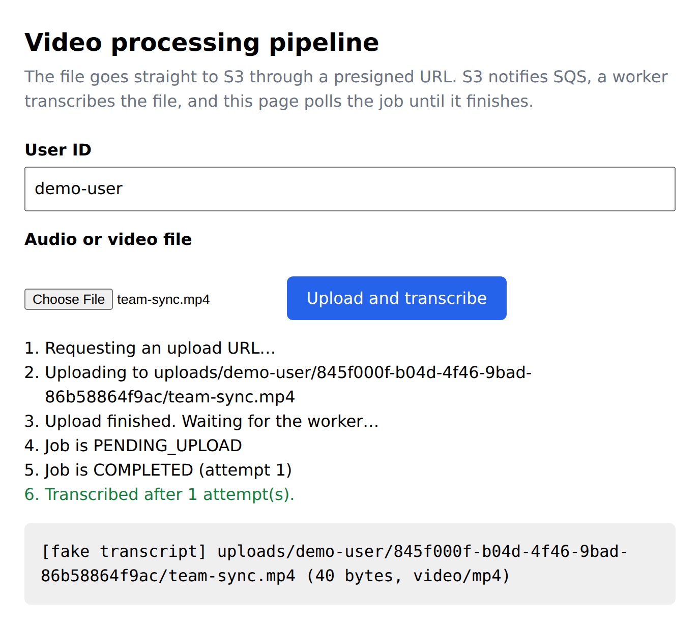
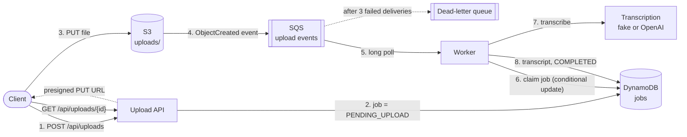
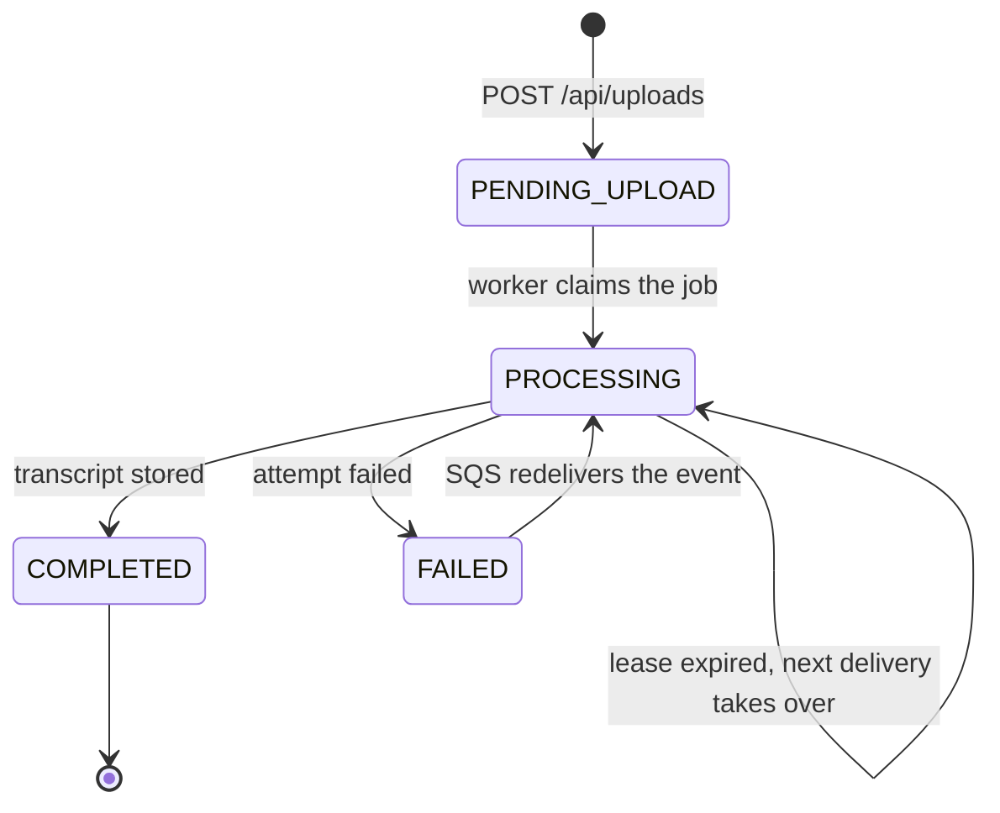
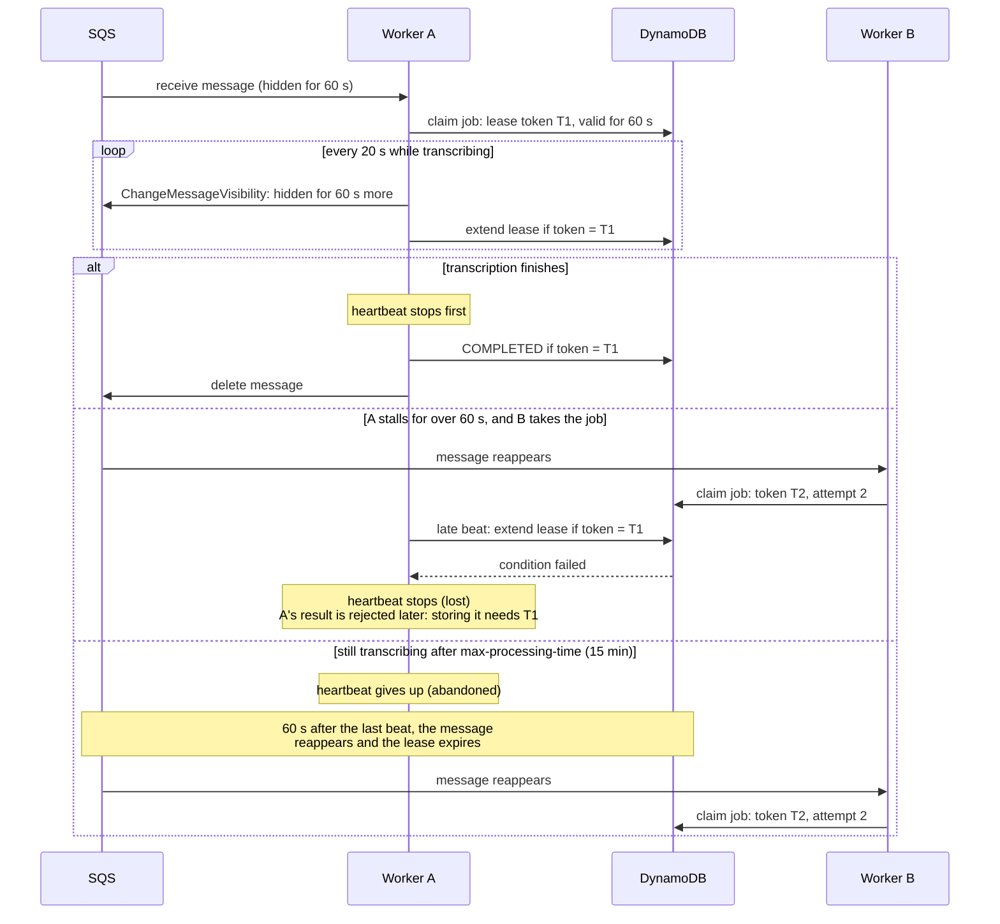

# video-processing-pipeline

[](https://github.com/LindseyZ1205/video-processing-pipeline/actions/workflows/ci.yml)
[](https://github.com/LindseyZ1205/video-processing-pipeline/actions/workflows/codeql.yml)

A Spring Boot service that takes audio and video uploads and transcribes them asynchronously on AWS.

Clients upload straight to S3 with a presigned URL. S3 announces each new object on an SQS queue, and a worker
picks up the event, transcribes the file and records the result in DynamoDB. Every hop delivers at least once, so
the worker is idempotent: it retries transient failures and leaves poison messages in a dead-letter queue.

Everything runs locally on [LocalStack](https://github.com/localstack/localstack). The integration tests run the
whole flow against it with Testcontainers.

**Stack:** Java 17, Spring Boot 3.5, AWS SDK for Java v2 (S3, SQS, DynamoDB), Micrometer + Prometheus, Terraform, Docker, LocalStack, Testcontainers, GitHub Actions.



*The demo page after an upload, run with `docker compose up --build` and opened at http://localhost:8080. The
transcript comes from the default fake provider. The browser test in CI took this screenshot.*

## Architecture



1. The client asks for an upload. The API checks the file type and declared size, records a `PENDING_UPLOAD` job,
   and returns a presigned PUT URL that is valid for 15 minutes.
2. The client uploads the file directly to S3. The file's bytes never pass through the service.
3. S3 publishes an `ObjectCreated` event for every key under `uploads/` to the SQS queue.
4. The worker long-polls the queue, claims the job in DynamoDB, transcribes the file and stores the transcript.
5. The client polls `GET /api/uploads/{id}` until the job is `COMPLETED`.

A job moves through these states:



## Design decisions

### Presigned URLs instead of uploading through the API

Proxying video through the service would tie up request threads and bandwidth for the length of every upload.
With a presigned URL the service only signs a request, and S3 takes the bytes.

- The URL is valid for 15 minutes and signs the object key and the `Content-Type`. The client can't pick a
  different key or type without breaking the signature.
- The object key is `uploads/{userId}/{uploadId}/{sanitized file name}`. The upload ID is a fresh UUID for every
  URL, so uploads never overwrite each other.
- A presigned PUT can't cap the file size by itself. The API rejects oversized declared sizes, and the worker checks
  the real size with `HeadObject` before it does any work. To enforce the limit inside S3, you would use a
  presigned POST policy with `content-length-range`.

### Idempotent upload requests

A client whose `POST /api/uploads` times out can't tell whether the upload was created, so it retries, and without
protection every retry creates another job. A request may carry an `Idempotency-Key` header, as with Stripe's API:

- **One transaction.** The pending job and a record of the key, `{userId}#{key}`, are written with a single
  `TransactWriteItems`, each conditioned on not existing yet. Either both exist or neither does, so even concurrent
  retries create one job.
- **A retry gets the same upload.** When the key exists, the earlier upload comes back with the same upload ID and
  object key, a freshly signed URL, and `Idempotent-Replayed: true`.
- **A key means one request.** The record holds a SHA-256 hash of the file name, type and size. The same key with
  different details gets `422`. A retry that races the first request, before it committed, gets `409` and retries.
- **Cheap to keep.** Key records live in the jobs table under their own prefix (job IDs are UUIDs, so they can't
  collide) and expire through the same TTL after 24 hours. The transaction costs two writes instead of one.

### At-least-once delivery, made safe with idempotency

S3 event notifications and SQS standard queues both deliver *at least once*. The same upload can arrive twice, and
two workers can receive copies at the same moment. Instead of trying to prevent duplicates, the worker makes them
harmless:

- **One job per upload.** The job ID is the upload ID read from the object key, so every copy of an event maps to
  the same DynamoDB item.
- **Claiming is atomic.** A worker claims a job with a single conditional `UpdateItem`. The update succeeds only if
  the job is new, pending, failed, or stuck in `PROCESSING` with an expired lease. DynamoDB evaluates the condition
  and applies the update atomically, so exactly one worker wins.
- **Leases are fenced.** The winning worker gets a random lease token, and completing or failing the job is
  conditioned on that token. A worker that stalls past its lease can't overwrite the result of the worker that took
  over.
- **Losers check why they lost.** If the job is already `COMPLETED`, the message is a duplicate and is deleted. If
  another worker holds a live lease, the job also records which SQS message that worker claimed it through. A
  different message is a duplicate of work in progress and is deleted too: the claiming message stays on the queue
  until the job is done, and comes back if its worker dies. Only a redelivery of the claiming message itself stays on
  the queue, to come back after the visibility timeout. Otherwise a duplicate of a long transcription would keep
  coming back busy until it landed in the dead-letter queue.

The transcription call itself can still run twice in rare cases: for example, a worker dies after transcribing but
before recording the result. That is the at-least-once contract, and `TranscriptionService` implementations must
tolerate it.

### Retries and the dead-letter queue

- A message is deleted only after its job is recorded as done. On any other outcome the message stays on the queue,
  and SQS redelivers it once it becomes visible again, so retries need no code of their own.
- Failed attempts back off. The worker reads the message's `ApproximateReceiveCount` and hides it with
  `ChangeMessageVisibility`: one visibility timeout after the first delivery, two after the second, four after the
  third, up to `max-retry-delay` (15 min). Up to 20% is added at random, so messages that failed together, say while
  the provider was rate limiting, don't all come back at once. A busy job keeps the plain visibility timeout, so a
  crashed worker's job is still picked up within a minute.
- A provider that is rate limiting or briefly down can say how long to wait. When OpenAI answers 429 or 503 with a
  `Retry-After` header, in seconds or as an HTTP date, the attempt fails as usual, but the message waits at least that
  long: the longer of the backoff and the provider's wait, plus the jitter, up to `max-retry-delay`. A shorter
  `Retry-After` doesn't shorten the backoff. With three attempts, a provider that kept asking for one more second
  would otherwise use them all up within seconds.
- The last delivery doesn't back off. The worker reads `maxReceiveCount` from the queue's redrive policy when it
  starts. When that delivery fails, it makes the message visible again right away, and the next receive moves it to
  the dead-letter queue. Waiting out the backoff first would only hold back the move and its alert, four minutes with
  the defaults. A queue without a redrive policy backs off on every delivery.
- The worker sets the visibility timeout on every `ReceiveMessage` and uses the same value as the job lease. When a
  crashed worker's message reappears, its lease has already expired, so the next delivery can take over.
- Long work keeps its claim with a heartbeat, up to a limit. See
  [Heartbeats for long transcriptions](#heartbeats-for-long-transcriptions).
- After `maxReceiveCount` (3) deliveries, SQS moves the message to the dead-letter queue. From there it can be
  inspected, and once the cause is fixed, [`scripts/redrive-dlq.sh`](scripts/redrive-dlq.sh) moves it back with an
  SQS message move task. The [runbook](docs/runbook.md) walks through it.
- Failures that a retry can't fix, like a file over the size limit or a format the provider rejects, mark the job
  `FAILED` and delete the message right away, so they don't use up retries.
- If DynamoDB or S3 is unreachable, the worker doesn't guess. The message stays on the queue, and the failure-rate
  alert sees the outage either way: an S3 error fails the attempt, and a DynamoDB error escapes the handler and counts
  as an `error`.
- S3 also sends an `s3:TestEvent` when a notification is first configured. The worker recognizes it and drops it.

### Heartbeats for long transcriptions

A transcription can run longer than the visibility timeout. Left alone, SQS would redeliver the message midway, and
once the lease ran out another worker would take the job over and transcribe the file a second time. So while a file
is being transcribed, a heartbeat runs every `heartbeat-interval` (20 s). Each beat resets the message's visibility
timeout and extends the job lease, conditioned on the lease token:



- The heartbeat runs only while the file is being transcribed. It lets go of the lease before the result is
  written, so a late beat can't race with that write, and a failed attempt still comes back after the normal
  visibility timeout. A crashed worker simply stops beating.
- If an extension finds the lease already lost, the heartbeat stops. Because the lease is fenced, the stalled
  worker's result is rejected when it tries to store it.
- After `max-processing-time` (15 min) the heartbeat gives up, because a transcription that hangs would otherwise
  hold its job indefinitely. Its lease then runs out, and the next delivery takes the job over. Requests to OpenAI
  time out after 5 minutes, so a stalled request normally fails well before that.
- Each extension's outcome is counted in `pipeline_lease_extensions_total` (`extended`, `lost`, `failed`,
  `abandoned`), and the `JobLeasesKeepGettingLost` alert warns when leases keep getting lost.

### Pluggable transcription

`TranscriptionService` is a one-method interface:

| Provider | Setting | What it does |
|---|---|---|
| `fake` (default) | nothing | Returns a placeholder transcript. No keys needed, so it runs anywhere, including CI. |
| `openai` | `OPENAI_API_KEY` | Sends the file to OpenAI's `/audio/transcriptions` endpoint (`whisper-1`, 25 MB limit). |

AWS Transcribe would fit behind the same interface. Because Transcribe runs its jobs asynchronously, a production
version would start a Transcribe job and complete the pipeline job from Transcribe's completion event, rather than
block a worker thread while it runs.

## API

Interactive docs: with the service running, open <http://localhost:8080/swagger-ui.html>. springdoc generates the
OpenAPI document from the code, so the docs can't drift from the endpoints. The raw JSON is at `/v3/api-docs`.

**Create an upload**

```http
POST /api/uploads
Content-Type: application/json

{ "userId": "demo-user", "fileName": "team-sync.mp4", "contentType": "video/mp4", "sizeBytes": 10485760 }
```

```http
HTTP/1.1 201 Created
Location: /api/uploads/0f8fad5b-d9cb-469f-a165-70867728950e

{
  "uploadId": "0f8fad5b-d9cb-469f-a165-70867728950e",
  "objectKey": "uploads/demo-user/0f8fad5b-d9cb-469f-a165-70867728950e/team-sync.mp4",
  "uploadUrl": "http://localhost:4566/video-uploads/uploads/demo-user/...&X-Amz-Signature=...",
  "method": "PUT",
  "headers": { "Content-Type": "video/mp4" },
  "expiresAt": "2026-09-28T19:15:00Z"
}
```

Only `audio/*` and `video/*` types are accepted, up to 100 MB. Anything else gets `400` with a problem-details body.
To make retries safe, send an `Idempotency-Key` header: up to 128 letters, digits, `-`, `_`, `.` or `:`, such as a
UUID. A retry with the same key and the same details returns the same upload with `Idempotent-Replayed: true`. The
same key with different details gets `422`, and a retry racing the first request may get `409`. Keys are kept for 24
hours, per `userId`.

Then upload the file with the returned method, URL and headers:

```bash
curl -X PUT -H "Content-Type: video/mp4" --upload-file team-sync.mp4 "$UPLOAD_URL"
```

**Check the job**

```http
GET /api/uploads/{uploadId}
```

```json
{
  "uploadId": "0f8fad5b-d9cb-469f-a165-70867728950e",
  "status": "COMPLETED",
  "attempts": 1,
  "transcript": "[fake transcript] uploads/demo-user/0f8fad5b-.../team-sync.mp4 (10485760 bytes, video/mp4)",
  "error": null,
  "updatedAt": "2026-09-28T19:00:03.512Z"
}
```

`status` is `PENDING_UPLOAD`, `PROCESSING`, `COMPLETED` or `FAILED`. An unknown ID returns `404`.

## Running locally

**With Docker only**, no Java needed:

```bash
docker compose up --build
```

Then open <http://localhost:8080>. A small page there uploads a file through the whole pipeline and shows the
transcript. The first build takes a few minutes, because Gradle downloads the dependencies inside the image. CI
publishes the image built from `main` to `ghcr.io/lindseyz1205/video-processing-pipeline`.

**For development**, with Java 17 and Docker:

```bash
docker compose up -d localstack
./gradlew bootRun --args='--spring.profiles.active=local'
```

The `local` profile points the AWS clients at LocalStack. On startup it creates the bucket, the queue and its
dead-letter queue, the S3 → SQS notification, and the DynamoDB table.

For real transcriptions:

```bash
OPENAI_API_KEY=sk-... ./gradlew bootRun --args='--spring.profiles.active=local --pipeline.transcription.provider=openai'
```

## Infrastructure

[`infra/terraform`](infra/terraform) defines everything the service needs in AWS:

- the upload bucket: private, encrypted, with a CORS rule for browser uploads and a lifecycle rule;
- the S3 → SQS notification, plus the queue policy that allows it;
- the event queue and its dead-letter queue;
- the jobs table with TTL;
- a least-privilege IAM policy for the service's role.

The service is configured entirely from one Terraform output, `service_environment`.

CI applies this configuration to LocalStack on every push. It then starts the service with only the Terraform
outputs, with the in-app bootstrap turned off, and runs [`scripts/smoke-test.sh`](scripts/smoke-test.sh): request an
upload, PUT a file, wait for the transcript. That tests the infrastructure code and the service against each other,
not only each one on its own. [infra/terraform/README.md](infra/terraform/README.md) explains how to apply it to AWS.

## Observability

Metrics are exported for Prometheus at `/actuator/prometheus`:

| Metric | Type | What it shows |
|---|---|---|
| `pipeline_events_total{outcome}` | counter | Every S3 event record the worker handled: `processed`, `duplicate`, `busy`, `failed`, `rejected`, `ignored`, or `error` when handling threw (DynamoDB unreachable, unreadable message) |
| `pipeline_transcription_seconds{outcome}` | histogram | Time spent in the transcription provider, by `success` or `failure` |
| `pipeline_events_lag_seconds` | histogram | From the upload finishing to a worker starting on it: queueing plus retry delays |
| `pipeline_queue_messages{queue,state}` | gauge | Visible and in-flight messages on the event queue and the dead-letter queue, refreshed every 30 s |
| `pipeline_sqs_receive_errors_total` | counter | Failed polls of SQS |
| `pipeline_lease_extensions_total{outcome}` | counter | Heartbeat attempts to extend a job's lease: `extended`, `lost` (another worker had taken the job over), `failed` (the DynamoDB call errored) or `abandoned` (the work ran past `max-processing-time`) |

[`monitoring/alerts.yml`](monitoring/alerts.yml) turns these metrics into Prometheus alert rules:

| Alert | Fires when | Severity |
|---|---|---|
| `UploadEventsInDeadLetterQueue` | a message has sat in the dead-letter queue for 5 minutes | page |
| `UploadEventsFailing` | more than 10% of attempts failed or errored, for 10 minutes | warn |
| `SlowUploadPickup` | the p95 time from upload to pickup stays above 2 minutes, for 10 minutes | warn |
| `WorkerCannotReachSqs` | polling SQS keeps failing, for 10 minutes | page |
| `JobLeasesKeepGettingLost` | running jobs keep losing their lease to another worker, for 15 minutes | warn |

Each rule has unit tests in [`monitoring/alerts.test.yml`](monitoring/alerts.test.yml): synthetic series where it
must fire, and where it must stay quiet. CI runs `promtool check rules` and `promtool test rules` in the `build` job.
Every alert also has a `runbook_url` annotation that links to its section of the [runbook](docs/runbook.md): what
the alert means, how to find the affected uploads, and how to recover.

Log lines about a message or a job carry its `messageId` and `jobId` in the MDC. With
`LOGGING_STRUCTURED_FORMAT_CONSOLE=ecs` every line is JSON with those IDs as separate fields, so one upload's whole
history is a single query in CloudWatch Logs Insights or Elasticsearch. The CI smoke test runs the service this way and
checks that the IDs appear.

## Tests

```bash
./gradlew test
```

The integration tests need Docker. They run on every push in [GitHub Actions](.github/workflows/ci.yml).

- `PipelineIntegrationTest` starts LocalStack with Testcontainers and runs the real flow: presigned upload,
  S3 notification, SQS, worker, DynamoDB. The visibility timeout is shortened to 3 seconds so retries are quick. It
  checks that:
  - an uploaded file ends up `COMPLETED` with its transcript;
  - the same event delivered three times is transcribed exactly once;
  - a retried upload request with the same `Idempotency-Key` gets the same upload, and its replayed URL works; the
    key can't be reused for different details, belongs to one user, and five concurrent requests with it create one
    upload;
  - a duplicate that arrives while the job is still running is dropped right away;
  - a failed attempt is retried and then succeeds;
  - a rate-limited attempt is retried no sooner than the provider's `Retry-After` asked;
  - an event that keeps failing lands in the dead-letter queue after 3 attempts, its retries back off, and the last
    one goes to the dead-letter queue without waiting;
  - a transcription that runs longer than two visibility timeouts is still processed exactly once (the heartbeat),
    and the lease extensions show up in the metrics with none lost;
  - a transcription that hangs is given up on after `max-processing-time`, and the next delivery completes the job;
  - the Prometheus endpoint reports the pipeline's metrics.
- `UploadEventHandlerTest` covers the delete-or-keep decision for each situation: success, duplicate of a completed
  job, duplicate of a job still running, redelivery of the message that holds the lease, lease lost, transient
  failure (with and without a wait the provider asked for), permanent failure, unreachable job store, unreadable
  message, S3 test event. It also checks the metric that each case records, and that a lease is kept alive only while
  the file is being transcribed.
- `UploadEventWorkerTest` checks both backoffs: the wait after a failed attempt (doubling per delivery, the cap,
  the jitter, a longer wait the provider asked for, none after the last delivery the redrive policy allows) and the
  pause in polling after SQS errors.
- `HeartbeatTest` checks that each beat extends both the message and the lease, and that beating stops when the
  work ends, when the lease is lost, and once the work runs past `max-processing-time`. It also checks the outcome
  each extension records, including when DynamoDB can't be reached.
- `QueueDepthGaugesTest` checks the queue depth gauges, including that they keep their last value while SQS is
  unreachable.
- `OpenAiTranscriptionServiceTest` checks the multipart request, how errors are classified and how `Retry-After` is
  read (seconds or a date), against a mock server, and that a request that never gets an answer times out.
- `S3EventNotificationTest` and `UploadKeyTest` cover event parsing (including URL-encoded keys) and key sanitizing.
- The `terraform + smoke test` CI job checks `terraform fmt`, applies [`infra/terraform`](infra/terraform) to
  LocalStack, and runs the smoke test against the service configured from the Terraform outputs. Then it checks that
  service's Prometheus metrics and JSON logs. It also rehearses the runbook's recovery: before the service starts, an
  upload's event is received three times without being deleted, so SQS moves it to the dead-letter queue; after the
  smoke test, `scripts/redrive-dlq.sh` moves it back and the upload completes.
- `shellcheck` checks the scripts in `scripts/` in the `build` job.
- The `docker compose + smoke test` CI job builds the image, starts the stack with `docker compose up`, and runs the
  same smoke test. On `main` it then publishes the image to GHCR. Runs on `main` never overlap, so `latest` is always
  the image of the newest commit.
- The same job then runs a browser test ([`e2e/tests/upload.spec.ts`](e2e/tests/upload.spec.ts)). Playwright opens
  the demo page in Chromium, picks a file, and waits for the transcript. That covers what the API smoke test can't:
  the page's JavaScript, and the browser's cross-origin PUT straight to S3, which breaks if CORS or the presigned
  URL's address is wrong. It also takes the screenshot at the top of this README, `docs/demo.png`, and every run
  uploads a fresh copy as the `demo-screenshot` artifact. To run it against a local stack:

  ```bash
  docker compose up --build -d
  cd e2e && npm ci && npx playwright install chromium && npx playwright test
  ```

Each CI run puts line and branch coverage (JaCoCo, unit and integration tests combined) in the run summary, and
uploads the HTML report as the `coverage-report` artifact.

### How changes reach `main`

- **Branch protection.** Nothing merges into `main` unless four checks have passed on the pull request: `build`,
  `terraform + smoke test`, `docker compose + smoke test` and `analyze (java-kotlin)`. The rule applies to admins
  too, and `main` can't be force-pushed or deleted.
- **Auto-merge.** A pull request set to auto-merge lands as soon as those checks pass, and GitHub then deletes its
  branch. If a check fails, the pull request stays open until a fix turns it green. Dependabot's pull requests turn
  auto-merge on by themselves ([`dependabot-auto-merge.yml`](.github/workflows/dependabot-auto-merge.yml)), so an
  update that passes CI lands without anyone clicking anything.

### Keeping it current

- **Dependabot** opens update PRs every week: one grouped PR for minor and patch Gradle updates, one for GitHub
  Actions, one for the Terraform provider, and one for Playwright. CI decides whether each is safe to merge. Upgrades that are migrations
  rather than bumps, Spring Boot 4 and AWS provider 6, are excluded. Dependabot alerts are on too: a known
  vulnerability in a dependency raises an alert and gets a fix PR.
- **CodeQL** scans the Java code on every PR, on `main`, and every Monday, so new queries also run against code
  that hasn't changed.

## Performance

[`load/upload.js`](load/upload.js) is a k6 scenario that drives the whole pipeline at a fixed arrival rate. Every
iteration requests an upload, PUTs the file to S3, and waits for the transcript. Pipeline latency runs from S3 having
the file until the transcript is stored. It is taken from the job's own timestamp, so the client's polling interval
doesn't skew it. [`load-test.yml`](.github/workflows/load-test.yml) runs it by hand, one minute per rate, against the
docker compose stack on a single GitHub-hosted runner (4 vCPU).

[Run 38325430484](https://github.com/LindseyZ1205/video-processing-pipeline/actions/runs/38325430484), 2026-10-13:

| Uploads started/s | Completed | Dropped by k6 | Latency p50 | p95 | p99 | max |
|---|---|---|---|---|---|---|
| 10 | 600 of 600 | 0 | 16 ms | 25 ms | 228 ms | 393 ms |
| 20 | 1,200 of 1,200 | 0 | 14 ms | 18 ms | 31 ms | 178 ms |
| 40 | 2,401 of 2,401 | 0 | 15 ms | 389 ms | 458 ms | 485 ms |
| 80 | 419 of 419 | 4,381 | 82 s | 107 s | 107 s | 107 s |

- Every upload that k6 started was processed exactly once. The worker recorded 4,620 `processed` events for 4,620
  uploads, and no duplicates, retries or failures.
- Up to 40 uploads/s, latency stays in the tens of milliseconds, and queueing starts to show in the p95 at 40/s.
  Somewhere between 40 and 80 uploads/s this setup falls over: at 80/s a backlog built up, k6's 300 virtual users all
  ended up waiting on slow uploads, it dropped 4,381 starts, and latency climbed past 100 s.
- Where exactly it falls over, and which part saturates first, this run can't say. k6 and its status polling,
  LocalStack (including the DynamoDB that the API and the worker share) and the service all share four vCPUs, and the
  polling grows with the backlog. So these numbers are a baseline for comparing changes on the same setup, not a
  capacity estimate for AWS, where the transcription provider would also be a real one.

To rerun it, or to probe other rates: `gh workflow run load-test.yml -f rates="40 50 60 70"`.

## Configuration

All settings live under `pipeline.*` in [`application.yml`](src/main/resources/application.yml).

| Property | Default | Meaning |
|---|---|---|
| `pipeline.aws.endpoint` | empty | AWS endpoint override, e.g. `http://localhost:4566` for LocalStack |
| `pipeline.aws.presign-endpoint` | empty | Endpoint written into presigned URLs, if browsers reach S3 at a different address than the service does (docker compose) |
| `pipeline.aws.bootstrap-resources` | `false` | Create the bucket, queues and table on startup (LocalStack only) |
| `pipeline.bucket` | `video-uploads` | Upload bucket |
| `pipeline.queue.name` / `dead-letter-name` | `video-upload-events` / `…-dlq` | Event queue and its DLQ |
| `pipeline.queue.max-receive-count` | `3` | Deliveries before a message moves to the DLQ |
| `pipeline.upload.url-ttl` | `15m` | Presigned URL lifetime |
| `pipeline.upload.max-file-size` | `100MB` | Size limit, checked at upload request and again by the worker |
| `pipeline.worker.concurrency` | `2` | Poller threads |
| `pipeline.worker.visibility-timeout` | `60s` | Retry delay, and how long a crashed worker's job stays claimed |
| `pipeline.worker.heartbeat-interval` | `20s` | How often running work extends its message and lease; shorter than the visibility timeout |
| `pipeline.worker.max-retry-delay` | `15m` | Cap on the wait after a failed attempt, which starts at one visibility timeout and doubles per delivery, including a longer wait the provider asks for |
| `pipeline.worker.max-processing-time` | `15m` | When the heartbeat gives up on an attempt, so a hung one gets taken over; longer than the visibility timeout |
| `pipeline.jobs.retention` | `7d` | Job records expire through DynamoDB TTL on `expiresAt` |
| `pipeline.transcription.provider` | `fake` | `fake` or `openai` |
| `pipeline.transcription.openai.timeout` | `5m` | How long to wait for OpenAI's answer before the attempt fails and SQS retries it |
| `pipeline.metrics.queue-depth-interval` | `30s` | How often the queue depth gauges are read from SQS |

Against real AWS, leave the endpoint empty so the SDK uses its default credential chain. The resource names come
from `terraform output -json service_environment` ([Infrastructure](#infrastructure)), not from `bootstrap-resources`.
Environment variables such as `PIPELINE_BUCKET` override any of these settings.

## Project layout

```
src/main/java/io/github/lindseyz1205/videopipeline/
├── upload/         REST API, presigned URLs, object key layout
├── processing/     SQS poller, S3 event parsing, idempotent event handler, metrics
├── job/            job state and leases in DynamoDB
├── transcription/  TranscriptionService and its fake / OpenAI providers
└── config/         AWS clients, settings, LocalStack bootstrap
infra/terraform/    AWS resources and the service's IAM policy
scripts/            end-to-end smoke test, dead-letter queue redrive
e2e/                browser test of the demo page (Playwright)
monitoring/         Prometheus alert rules and their unit tests
load/               k6 load test of the whole pipeline
docs/               runbook for the alerts, demo screenshot
```

## Not covered yet

- **Authentication.** `userId` comes from the request body. A real service would take it from the caller's identity.
- **Deployment.** Terraform covers the resources the service uses, and there is a container image, but nothing runs
  the image yet: no compute (ECS, App Runner) and no remote Terraform state.
- **Large files.** Multipart uploads, and a POST policy to enforce the size limit in S3.
- **Dashboards and alert routing.** The alert rules are tested, but there's no Grafana dashboard, and no Alertmanager
  configuration decides who gets paged.

## License

[MIT](LICENSE)
